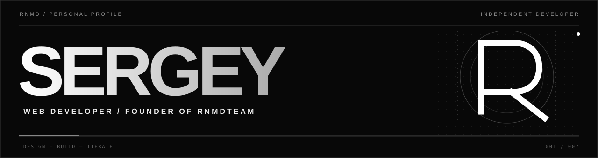
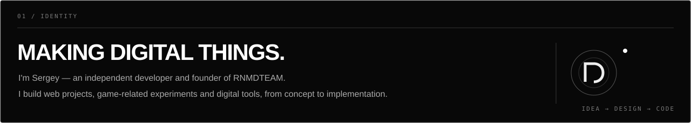
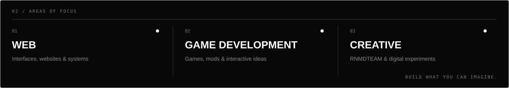
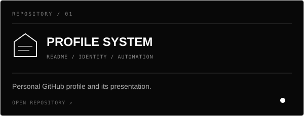
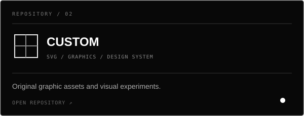
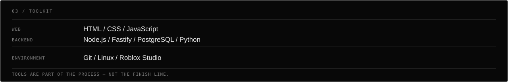
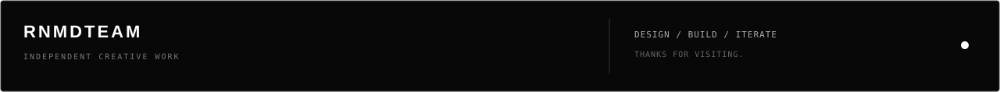

# RNMD / GRAPHIC SYSTEM

The current black-and-white visual identity used by [Sergey's GitHub profile](https://github.com/sergeyrenamed-coder).

**Everything is drawn as SVG.** The profile README is built from image assets only — no markdown headings, badges or plain-text sections.

## 01 / PROFILE

## 02 / REPOSITORY CARDS

<table>
<tr>
<td width="50%">

</td>
<td width="50%">

</td>
</tr>
</table>

## 03 / TOOLKIT & FOOTER

## DESIGN TOKENS

| Token | Value |
|:--|:--|
| Background | `#080808` |
| Primary | `#FFFFFF` |
| Secondary | `#AAAAAA` |
| Muted | `#666666` |
| Border | `#373737` |

## FILES

- `assets/system-hero.svg`
- `assets/system-about.svg`
- `assets/system-focus.svg`
- `assets/system-profile-repo.svg`
- `assets/system-custom-repo.svg`
- `assets/system-toolkit.svg`
- `assets/system-footer.svg`

SVG animation is limited to slow opacity pulses and one subtle moving line. No scripts, external fonts or JavaScript are required.
