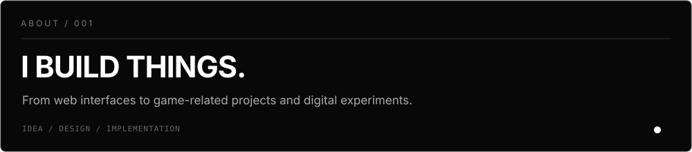
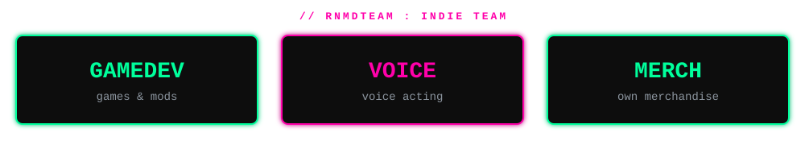
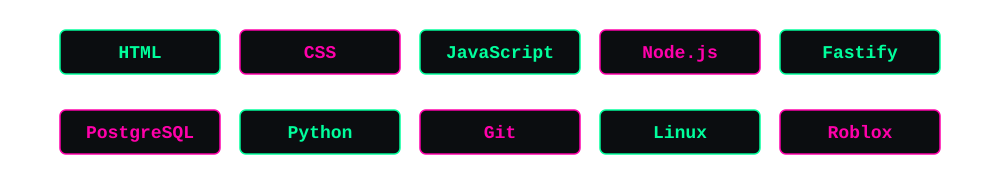
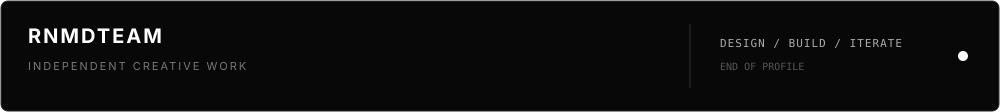

# Custom

**A small collection of original monochrome SVG assets for the [Sergey_Renamed GitHub profile](https://github.com/sergeyrenamed-coder).**

The visual system is intentionally restrained: near-black backgrounds, white typography, muted gray details, thin borders and a precise grid.

## Assets

<table>
  <tr>
    <td width="50%">
      <strong>Banner</strong><br />
      <sub>Main profile header</sub><br /><br />
      
    </td>
    <td width="50%">
      <strong>About</strong><br />
      <sub>Introductory statement</sub><br /><br />
      
    </td>
  </tr>
  <tr>
    <td>
      <strong>Team</strong><br />
      <sub>RNMDTEAM focus areas</sub><br /><br />
      
    </td>
    <td>
      <strong>Stack</strong><br />
      <sub>Selected technologies</sub><br /><br />
      
    </td>
  </tr>
  <tr>
    <td>
      <strong>Divider</strong><br />
      <sub>Section separator</sub><br /><br />
      
    </td>
    <td>
      <strong>Footer</strong><br />
      <sub>Profile closing graphic</sub><br /><br />
      
    </td>
  </tr>
</table>

## Design tokens

| Token | Value | Use |
|:--|:--|:--|
| Background | `#080808` | Main surfaces |
| Primary | `#FFFFFF` | Headlines and key details |
| Secondary | `#AAAAAA` | Supporting text |
| Muted | `#666666` | Metadata |
| Border | `#303030` | Dividers and outlines |

## Usage

Reference an asset directly from this repository:

```md

```

All graphics are standalone SVG files and can be reused in Markdown or other web projects.
