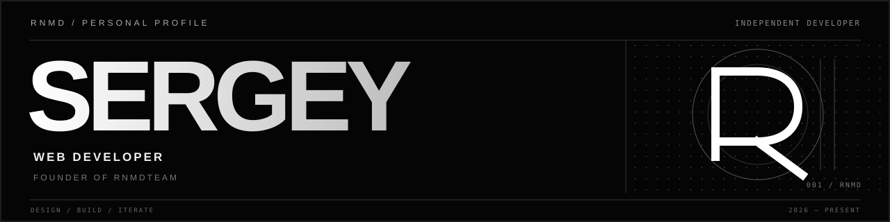
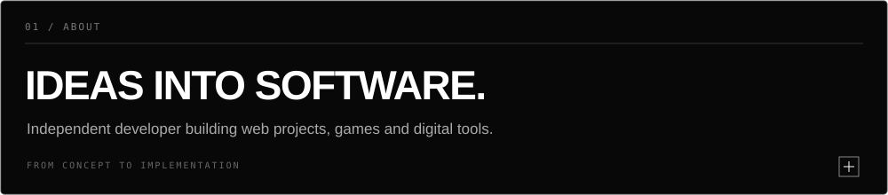
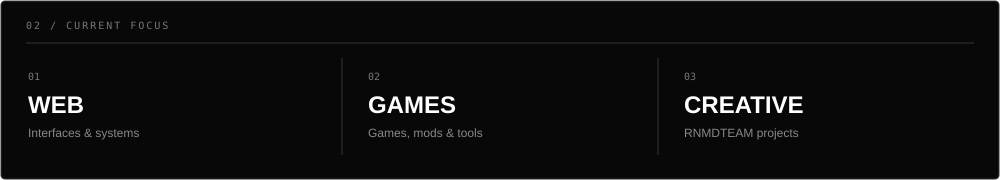
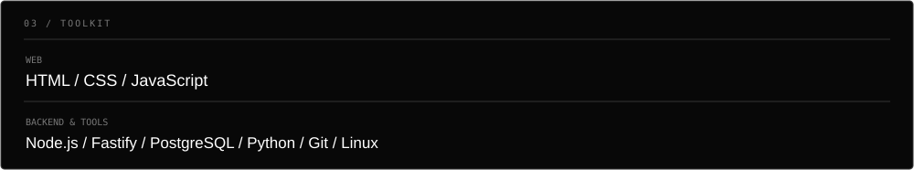
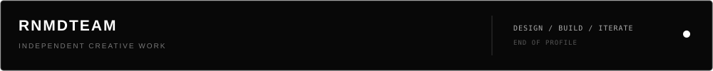
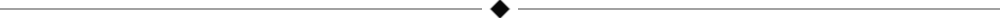

# CUSTOM / MONOCHROME ASSETS

A small visual system for the [Sergey_Renamed profile](https://github.com/sergeyrenamed-coder).

**Black. White. Space. Typography.**

All graphics are custom SVGs designed for GitHub Markdown. The new assets use unique filenames so GitHub does not keep displaying cached versions of the previous artwork.

## 01 / HERO

## 02 / PROFILE GRAPHICS

<table>
<tr>
<td width="50%" valign="top">

**About**

</td>
<td width="50%" valign="top">

**Focus**

</td>
</tr>
<tr>
<td width="50%" valign="top">

**Toolkit**

</td>
<td width="50%" valign="top">

**Footer**

</td>
</tr>
</table>

## 03 / DETAIL

## DESIGN TOKENS

| Token | Value |
|:--|:--|
| Background | `#080808` |
| Primary | `#FFFFFF` |
| Secondary | `#AAAAAA` |
| Muted | `#666666` |
| Border | `#353535` |

## FILES

- `assets/mono-banner.svg`
- `assets/mono-about.svg`
- `assets/mono-focus.svg`
- `assets/mono-stack.svg`
- `assets/mono-divider.svg`
- `assets/mono-footer.svg`

All SVGs are self-contained and can be embedded directly in Markdown.
